# Práctica de redes: red corporativa en Cisco Packet Tracer

**Módulo:** Sistemas Informáticos (1º DAM)
**Alumno:** Álvaro S.
**Fecha:** noviembre de 2026
**Programa:** Cisco Packet Tracer 9.0.1

En esta práctica he diseñado y montado en Packet Tracer una red formada por cinco redes principales y una red de servidores, todas unidas por routers. Hay una red dividida en subredes con VLSM y aislada del resto con listas de acceso, dos redes que reciben la IP por DHCP, una red mixta con cable y Wi-Fi, una red con IPs fijas y una red de servidores con tres páginas web y un servidor DNS.

El archivo de Packet Tracer es `practica_red_corporativa.pkt` y está en la raíz del repositorio.

## Contenido del repositorio

| Ruta | Qué hay |
|---|---|
| `practica_red_corporativa.pkt` | Proyecto de Packet Tracer |
| `README.md` | Esta documentación |
| `imagenes/` | Capturas que salen en este documento |
| `web/albacete/`, `web/wagner/`, `web/dilar/` | El `index.html` de cada servidor web y su foto |
| `configuraciones/` | Configuración de cada router y switch en texto |

## 1. Descripción general

La idea es simular la red de una empresa con varias sedes o departamentos. Cada red principal tiene su propio router y su propio switch, y todos los routers se conectan a un router central (`R-CENTRAL`), que es también el que da salida a la red de servidores. Así ningún router conecta directamente todas las redes, que era una de las condiciones del enunciado.

## 2. Objetivos

Los objetivos de la práctica eran:

- Diseñar el direccionamiento IPv4 de toda la red sin que se solapen subredes ni se repitan IPs.
- Usar VLSM para dividir una red en tres subredes de distinto tamaño.
- Configurar IPs estáticas y dinámicas (DHCP).
- Configurar routers y switches por consola y el enrutamiento entre redes.
- Montar una red inalámbrica protegida con WPA2-PSK.
- Instalar tres servidores web y un servidor DNS que resuelva sus nombres.
- Comprobar que todo funciona y documentarlo en GitHub con Markdown.

## 3. Topología

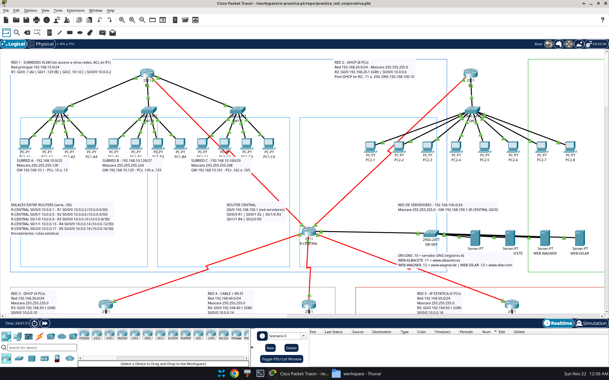

En la topología cada red está dentro de un recuadro de un color distinto y tiene una nota con su dirección de red, la máscara, la puerta de enlace y las interfaces del router. También hay una nota con los enlaces entre routers y otra con lo que hace cada servidor.

## 4. Redes y dispositivos

Todos los routers son Cisco 2911 y todos los switches son 2960-24TT. El 2911 solo trae tres puertos GigabitEthernet y ningún puerto serie, así que a cada router le he añadido una tarjeta **HWIC-2T** (dos puertos serie) para los enlaces entre routers. El router central lleva tres tarjetas HWIC-2T porque tiene que conectar con cinco routers.

| Red | Router | Switch | Equipos | Direccionamiento |
|---|---|---|---|---|
| Red 1 (VLSM) | R1 | SW1-A, SW1-B, SW1-C | 12 PCs (4 por subred) | Estático |
| Red 2 | R2 | SW2 | 8 PCs | DHCP (desde R2) |
| Red 3 | R3 | SW3 | 4 PCs | DHCP (desde R3) |
| Red 4 (mixta) | R4 | SW4 | 4 PCs por cable, 1 punto de acceso, 5 portátiles Wi-Fi | PCs estáticos, portátiles por DHCP (desde R4) |
| Red 5 | R5 | SW5 | 5 PCs | Estático |
| Servidores | R-CENTRAL | SW-SRV | SRV-DNS, WEB-ALBACETE, WEB-WAGNER, WEB-DILAR | Estático |

**Red 1.** Es la red que se divide con VLSM. En vez de meter las tres subredes en un mismo switch he puesto un switch para cada subred y cada uno va a una interfaz distinta de R1 (G0/0, G0/1 y G0/2). Cada subred necesita su propia puerta de enlace, y de esta forma cada interfaz del router es el gateway de una subred y me resulta más fácil aplicar una ACL distinta a cada una.

**Red 2 y Red 3.** Son dos redes normales con DHCP. El servidor DHCP es el propio router de cada red. Lo he hecho así porque el router ya está en la red, no hace falta poner otro equipo, y cada router reparte direcciones solo de su red, así que es imposible que se mezclen los rangos.

**Red 4.** Tiene cuatro PCs por cable con IP fija y un punto de acceso (AccessPoint-PT) conectado al switch. Los cinco portátiles se conectan por Wi-Fi al punto de acceso y reciben la IP por DHCP de R4. Como el AP funciona como un puente, los portátiles quedan en la misma red que los PCs de cable (192.168.40.0/24) y se pueden comunicar entre ellos. Los portátiles de Packet Tracer vienen con tarjeta de red de cable, así que en cada uno he quitado el módulo PT-LAPTOP-NM-1CFE y he puesto el **WPC300N**, que es inalámbrico.

**Red 5.** Cinco PCs con IP, máscara, puerta de enlace y DNS puestos a mano.

**Red de servidores.** Cuelga de la interfaz G0/0 de R-CENTRAL. Tiene el servidor DNS y los tres servidores web.

## 5. Tabla de direccionamiento IPv4

### Redes de equipos

| Red | Dirección de red | Máscara | Puerta de enlace | Rango usado | DHCP |
|---|---|---|---|---|---|
| Red 1 - Subred A | 192.168.10.0/25 | 255.255.255.128 | 192.168.10.1 | PCs .10 a .13 | No |
| Red 1 - Subred B | 192.168.10.128/27 | 255.255.255.224 | 192.168.10.129 | PCs .130 a .133 | No |
| Red 1 - Subred C | 192.168.10.160/29 | 255.255.255.248 | 192.168.10.161 | PCs .162 a .165 | No |
| Red 2 | 192.168.20.0/24 | 255.255.255.0 | 192.168.20.1 | 192.168.20.11 a .254 | Sí, en R2 (excluidas .1 a .10) |
| Red 3 | 192.168.30.0/24 | 255.255.255.0 | 192.168.30.1 | 192.168.30.11 a .254 | Sí, en R3 (excluidas .1 a .10) |
| Red 4 | 192.168.40.0/24 | 255.255.255.0 | 192.168.40.1 | PCs .11 a .14 (fijos), portátiles .21 a .254 | Sí, en R4 (excluidas .1 a .20) |
| Red 5 | 192.168.50.0/24 | 255.255.255.0 | 192.168.50.1 | PCs .11 a .15 | No |
| Servidores | 192.168.100.0/24 | 255.255.255.0 | 192.168.100.1 | .10 a .13 | No |

He usado redes 192.168.X.0 porque son privadas y el tercer octeto me sirve para saber de un vistazo de qué red es cada IP (10 para la Red 1, 20 para la Red 2, etc., y 100 para los servidores). En las redes con DHCP he dejado fuera del pool las primeras direcciones para el router y por si hubiera que poner algún equipo con IP fija. En la Red 4 he excluido hasta la .20 porque ahí están los cuatro PCs fijos y así el DHCP no puede dar una IP que ya está usada.

### Enlaces entre routers

Para los enlaces serie he usado subredes /30 de la red 10.0.0.0, que solo tienen dos IPs útiles, justo las que hacen falta en un enlace punto a punto.

| Enlace | Red | R-CENTRAL | Router hoja |
|---|---|---|---|
| R-CENTRAL - R1 | 10.0.0.0/30 | S0/0/0 10.0.0.1 | S0/0/0 10.0.0.2 |
| R-CENTRAL - R2 | 10.0.0.4/30 | S0/0/1 10.0.0.5 | S0/0/0 10.0.0.6 |
| R-CENTRAL - R3 | 10.0.0.8/30 | S0/1/0 10.0.0.9 | S0/0/0 10.0.0.10 |
| R-CENTRAL - R4 | 10.0.0.12/30 | S0/1/1 10.0.0.13 | S0/0/0 10.0.0.14 |
| R-CENTRAL - R5 | 10.0.0.16/30 | S0/2/0 10.0.0.17 | S0/0/0 10.0.0.18 |

### Interfaces de los routers

| Router | Interfaz | IP / máscara | Conecta con |
|---|---|---|---|
| R-CENTRAL | G0/0 | 192.168.100.1 /24 | SW-SRV (servidores) |
| R1 | G0/0 | 192.168.10.1 /25 | SW1-A (subred A) |
| R1 | G0/1 | 192.168.10.129 /27 | SW1-B (subred B) |
| R1 | G0/2 | 192.168.10.161 /29 | SW1-C (subred C) |
| R2 | G0/0 | 192.168.20.1 /24 | SW2 |
| R3 | G0/0 | 192.168.30.1 /24 | SW3 |
| R4 | G0/0 | 192.168.40.1 /24 | SW4 |
| R5 | G0/0 | 192.168.50.1 /24 | SW5 |

Las interfaces serie están en la tabla de enlaces de arriba.

### Equipos con IP fija

| Equipo | IP | Máscara | Gateway | DNS |
|---|---|---|---|---|
| PC1-A1 a PC1-A4 | 192.168.10.10 a .13 | 255.255.255.128 | 192.168.10.1 | - |
| PC1-B1 a PC1-B4 | 192.168.10.130 a .133 | 255.255.255.224 | 192.168.10.129 | - |
| PC1-C1 a PC1-C4 | 192.168.10.162 a .165 | 255.255.255.248 | 192.168.10.161 | - |
| PC4-1 a PC4-4 | 192.168.40.11 a .14 | 255.255.255.0 | 192.168.40.1 | 192.168.100.10 |
| PC5-1 a PC5-5 | 192.168.50.11 a .15 | 255.255.255.0 | 192.168.50.1 | 192.168.100.10 |
| SRV-DNS | 192.168.100.10 | 255.255.255.0 | 192.168.100.1 | 192.168.100.10 |
| WEB-ALBACETE | 192.168.100.11 | 255.255.255.0 | 192.168.100.1 | 192.168.100.10 |
| WEB-WAGNER | 192.168.100.12 | 255.255.255.0 | 192.168.100.1 | 192.168.100.10 |
| WEB-DILAR | 192.168.100.13 | 255.255.255.0 | 192.168.100.1 | 192.168.100.10 |

A los PCs de la Red 1 no les he puesto DNS porque esa red no puede salir a ninguna otra, tampoco a los servidores, así que no lo iban a poder usar.

## 6. Cálculos VLSM de la Red 1

Para la Red 1 he elegido la red privada **192.168.10.0/24**, que tiene 256 direcciones. Con VLSM se empieza siempre por la subred que más hosts necesita, para que las grandes no se queden sin hueco.

Para saber cuántos bits de host hacen falta uso la fórmula 2^n - 2 >= hosts (se restan 2 porque la dirección de red y la de broadcast no se pueden dar a ningún equipo).

**Subred A (100 hosts).**
2^6 - 2 = 62, no llega. 2^7 - 2 = 126, sí llega. Necesito 7 bits de host, así que la máscara es 32 - 7 = /25 (255.255.255.128). Cada bloque es de 128 direcciones.
Empieza en 192.168.10.0 y termina en 192.168.10.127.

**Subred B (30 hosts).**
2^5 - 2 = 30, justo. Son 5 bits de host, máscara /27 (255.255.255.224), bloques de 32.
Empieza donde acaba la A: 192.168.10.128, y termina en 192.168.10.159.

**Subred C (6 hosts).**
2^3 - 2 = 6, también justo. 3 bits de host, máscara /29 (255.255.255.248), bloques de 8.
Empieza en 192.168.10.160 y termina en 192.168.10.167.

| Subred | Hosts pedidos | Hosts posibles | Dirección de red | Máscara | Primera IP útil | Última IP útil | Broadcast |
|---|---|---|---|---|---|---|---|
| A | 100 | 126 | 192.168.10.0/25 | 255.255.255.128 | 192.168.10.1 | 192.168.10.126 | 192.168.10.127 |
| B | 30 | 30 | 192.168.10.128/27 | 255.255.255.224 | 192.168.10.129 | 192.168.10.158 | 192.168.10.159 |
| C | 6 | 6 | 192.168.10.160/29 | 255.255.255.248 | 192.168.10.161 | 192.168.10.166 | 192.168.10.167 |

Desde la 192.168.10.168 hasta la .255 queda libre por si más adelante hace falta otra subred.

En cada subred la primera IP útil es la del router (puerta de enlace) y los PCs van después. En la subred C hay que tener cuidado porque solo hay 6 IPs útiles: una para el router y cuatro para los PCs, así que sobra una. En la subred B la /27 da exactamente 30 IPs útiles y una de ellas es la del router. Lo he dejado así porque el enunciado pide capacidad para 30 hosts y la /27 la tiene, pero si algún día hubiera que conectar 30 PCs además del router habría que pasar esa subred a /26.

## 7. Configuración de los routers y enrutamiento

He organizado la red en estrella: R-CENTRAL en medio y los routers R1 a R5 alrededor, cada uno con un enlace serie hacia el central. Así se cumple que haya varios routers interconectados y además el camino entre dos redes siempre es el mismo (router de origen, R-CENTRAL y router de destino).

Para el enrutamiento he elegido **rutas estáticas** en lugar de OSPF. Lo he decidido porque con esta topología en estrella las rutas son muy pocas y muy claras:

- Cada router hoja (R1 a R5) solo conoce su red y el enlace con el central, así que le basta con una **ruta por defecto** hacia R-CENTRAL. Todo lo que no es suyo lo manda al central.
- R-CENTRAL sí tiene que saber dónde está cada red, así que tiene una ruta estática por cada red principal apuntando al router que la tiene.

Con OSPF también funcionaría, pero tendría que configurarlo en los seis routers y para una red que no va a cambiar me parecía más fácil de entender y de comprobar con `show ip route` hacerlo con estáticas.

Rutas de R-CENTRAL:

```
ip route 192.168.10.0 255.255.255.0 10.0.0.2
ip route 192.168.20.0 255.255.255.0 10.0.0.6
ip route 192.168.30.0 255.255.255.0 10.0.0.10
ip route 192.168.40.0 255.255.255.0 10.0.0.14
ip route 192.168.50.0 255.255.255.0 10.0.0.18
```

Para la Red 1 he puesto una sola ruta con la /24 entera en vez de tres rutas, una por subred, porque las tres subredes están detrás de R1 y caben dentro de 192.168.10.0/24 (es como resumir las tres en una). La red de servidores no necesita ruta porque está conectada directamente a R-CENTRAL.

Rutas de los routers hoja (cambia solo la IP del siguiente salto):

```
R1: ip route 0.0.0.0 0.0.0.0 10.0.0.1
R2: ip route 0.0.0.0 0.0.0.0 10.0.0.5
R3: ip route 0.0.0.0 0.0.0.0 10.0.0.9
R4: ip route 0.0.0.0 0.0.0.0 10.0.0.13
R5: ip route 0.0.0.0 0.0.0.0 10.0.0.17
```

Ejemplo de la configuración de un router hoja (R5):

```
hostname R5
no ip domain-lookup
interface GigabitEthernet0/0
 description LAN Red 5 192.168.50.0/24
 ip address 192.168.50.1 255.255.255.0
 no shutdown
interface Serial0/0/0
 description Enlace con R-CENTRAL
 ip address 10.0.0.18 255.255.255.252
 no shutdown
ip route 0.0.0.0 0.0.0.0 10.0.0.17
```

En los enlaces serie, el extremo DCE es el que marca la velocidad con `clock rate`. Los he puesto en R-CENTRAL (`clock rate 64000` en sus cinco interfaces serie). La configuración completa de cada router y de cada switch está en la carpeta [`configuraciones/`](configuraciones/).

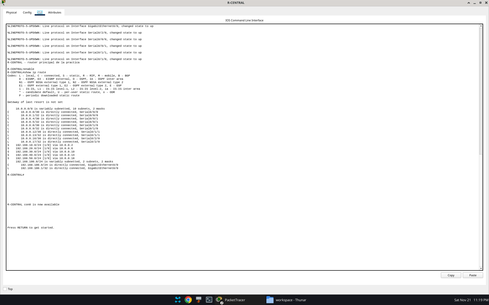

## 8. ACL de la Red 1

El enunciado pide que las tres subredes de la Red 1 no se comuniquen entre sí ni con las otras cuatro redes. Todas las subredes van al mismo router (R1), así que si no se hace nada el router las enruta entre ellas y hacia fuera. Para impedirlo he usado **listas de acceso extendidas con nombre** en R1.

He usado ACL extendidas porque tengo que filtrar por origen y por destino a la vez (una estándar solo mira el origen). Y las he puesto en R1, que es el router más cercano al origen del tráfico, para que los paquetes no permitidos se descarten antes de llegar a la red de R-CENTRAL.

Cada subred tiene su ACL aplicada en la entrada de su interfaz. Solo permite el tráfico que va a su propia subred (por ejemplo un ping al gateway) y deniega todo lo demás:

```
ip access-list extended SUBRED-A
 permit ip 192.168.10.0 0.0.0.127 192.168.10.0 0.0.0.127
 deny ip any any
ip access-list extended SUBRED-B
 permit ip 192.168.10.128 0.0.0.31 192.168.10.128 0.0.0.31
 deny ip any any
ip access-list extended SUBRED-C
 permit ip 192.168.10.160 0.0.0.7 192.168.10.160 0.0.0.7
 deny ip any any
```

Las wildcard son la máscara "al revés": para una /25 es 0.0.0.127, para una /27 es 0.0.0.31 y para una /29 es 0.0.0.7. El `deny ip any any` del final ya lo hace el router por defecto (la denegación implícita), pero lo he escrito para que se vea claro.

Con esto ya no sale nada de la Red 1, pero un PC de otra red todavía podría mandar un paquete hacia la Red 1 (la respuesta no volvería porque la bloquea la ACL de la subred). Para que el bloqueo sea también en el sentido contrario he puesto otra ACL en la entrada del enlace serie de R1, que deniega todo lo que va hacia 192.168.10.0/24 y deja pasar lo demás:

```
ip access-list extended ENTRADA-RED1
 deny ip any 192.168.10.0 0.0.0.255
 permit ip any any
```

Y así quedan aplicadas:

| Interfaz de R1 | ACL | Sentido |
|---|---|---|
| G0/0 (subred A) | SUBRED-A | in |
| G0/1 (subred B) | SUBRED-B | in |
| G0/2 (subred C) | SUBRED-C | in |
| S0/0/0 (hacia R-CENTRAL) | ENTRADA-RED1 | in |

He decidido que la Red 1 tampoco pueda llegar a la red de servidores. El enunciado habla de las otras cuatro redes, pero en las pruebas el DNS y la web solo tienen que funcionar desde las "redes autorizadas", y la Red 1 es la que no está autorizada. Si se quisiera dejar pasar a los servidores bastaría con añadir una línea `permit ip <subred> 192.168.100.0 0.0.0.255` antes del `deny` en cada ACL y otra igual al revés en ENTRADA-RED1.

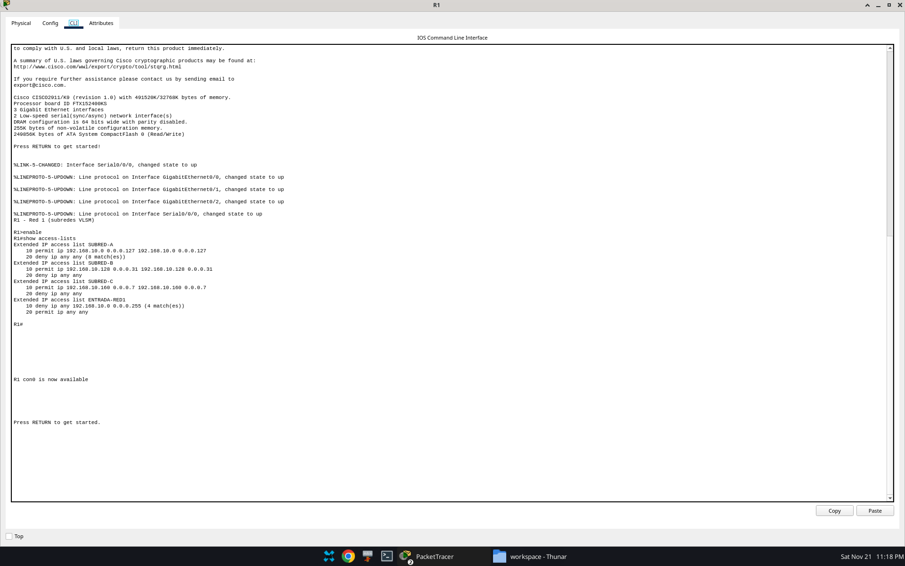

## 9. Servicios: DHCP, DNS, HTTP y Wi-Fi

### DHCP

El DHCP lo dan los routers R2, R3 y R4, cada uno para su red. En cada pool se configura la red, la puerta de enlace (`default-router`) y el servidor DNS (`dns-server`), que es lo que pide el enunciado. Por ejemplo en R2:

```
ip dhcp excluded-address 192.168.20.1 192.168.20.10
ip dhcp pool RED2
 network 192.168.20.0 255.255.255.0
 default-router 192.168.20.1
 dns-server 192.168.100.10
```

R3 es igual con la red 192.168.30.0 (pool RED3) y R4 con la 192.168.40.0 (pool RED4-WIFI) pero excluyendo de la .1 a la .20. Los PCs de las Redes 2 y 3 y los portátiles de la Red 4 tienen marcada la opción DHCP en IP Configuration.

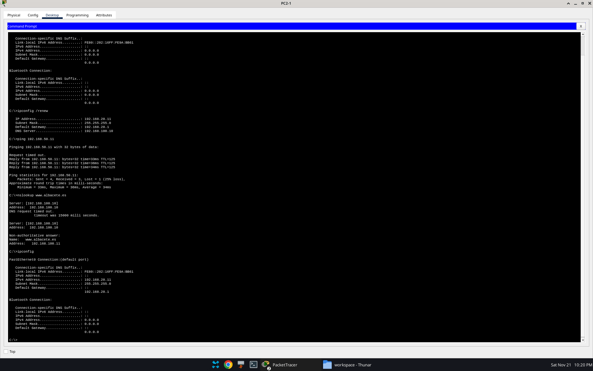

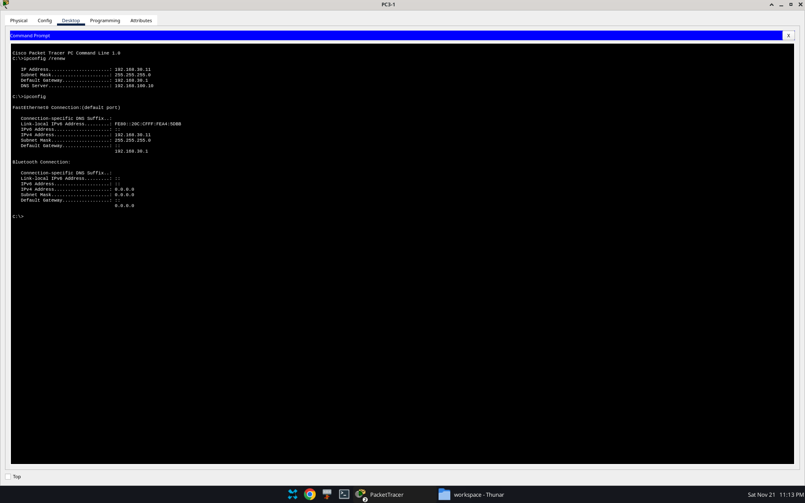

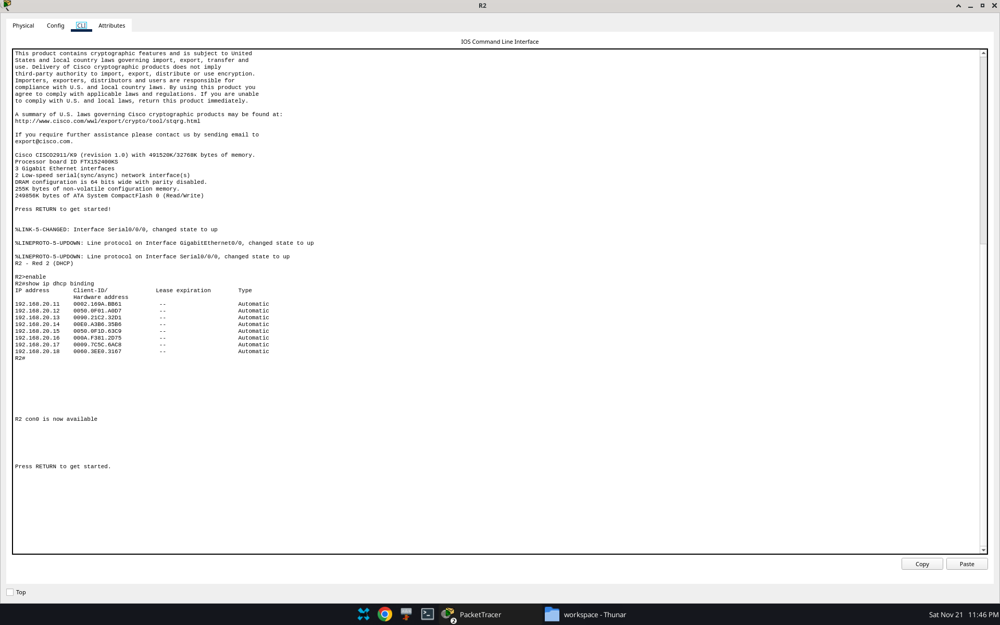

### DNS

El servidor SRV-DNS (192.168.100.10) tiene el servicio DNS activado con tres registros de tipo A, uno por cada web:

| Nombre | Tipo | Dirección |
|---|---|---|
| www.albacete.es | A | 192.168.100.11 |
| www.wagner.de | A | 192.168.100.12 |
| www.dilar.com | A | 192.168.100.13 |

Todos los equipos de las redes autorizadas tienen 192.168.100.10 como DNS: los de DHCP porque se lo da el router y los de IP fija porque se lo he puesto a mano. En SRV-DNS he desactivado el HTTP para que solo haga de DNS.

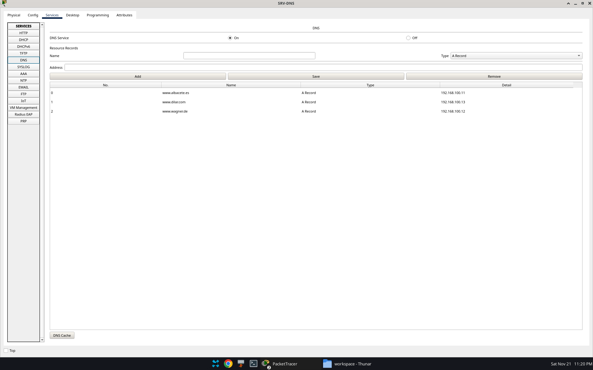

### HTTP

Cada servidor web tiene el servicio HTTP activado y un `index.html` propio con un título, una pequeña descripción y una foto. Las fotos son de Wikimedia Commons y las he reducido a unos 600 píxeles de ancho para que el servidor de Packet Tracer las cargue sin problema. Para subirlas hay que usar el botón *Import* del servicio HTTP del servidor, y en el HTML se cargan con `` (y lo mismo con las otras dos).

| Servidor | IP | Dominio | Archivos |
|---|---|---|---|
| WEB-ALBACETE | 192.168.100.11 | www.albacete.es | [`web/albacete/`](web/albacete/) |
| WEB-WAGNER | 192.168.100.12 | www.wagner.de | [`web/wagner/`](web/wagner/) |
| WEB-DILAR | 192.168.100.13 | www.dilar.com | [`web/dilar/`](web/dilar/) |

Autoría de las fotos:

- Albacete, Plaza del Altozano: Enrique Íñiguez Rodríguez (Qoan), [Wikimedia Commons](https://commons.wikimedia.org/wiki/File:Albacete._Plaza_del_Altozano_1.jpg), CC BY-SA 4.0.
- Richard Wagner: Franz Hanfstaengl, 1871, [Wikimedia Commons](https://commons.wikimedia.org/wiki/File:RichardWagner.jpg), dominio público.
- Dílar: Cristiandilar, [Wikimedia Commons](https://commons.wikimedia.org/wiki/File:D%C3%ADlar,_en_Granada_(Espa%C3%B1a).jpg), dominio público.

### Wi-Fi

El punto de acceso AP4 está conectado al puerto Fa0/5 de SW4. En *Config > Port 1* tiene:

| Opción | Valor |
|---|---|
| SSID | RED4-WIFI |
| Autenticación | WPA2-PSK |
| Cifrado | AES |
| Clave (PSK) | Wifi4Clase2026 |

En cada portátil, después de cambiar la tarjeta por la WPC300N, en *Config > Wireless0* he puesto el mismo SSID, WPA2-PSK, la misma clave y DHCP. El AP no tiene IP porque no la necesita para hacer de puente entre el Wi-Fi y el cable.

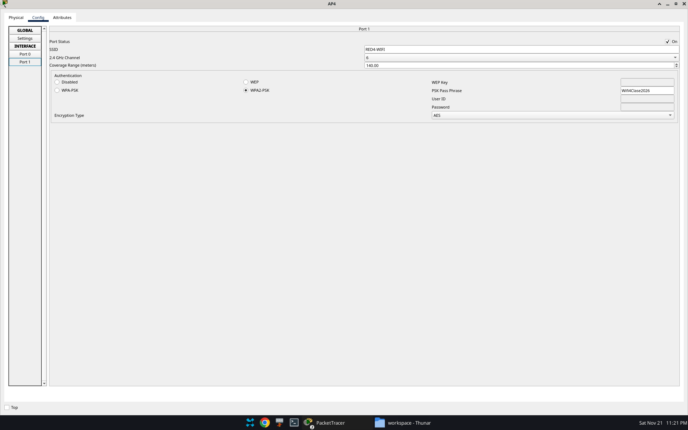

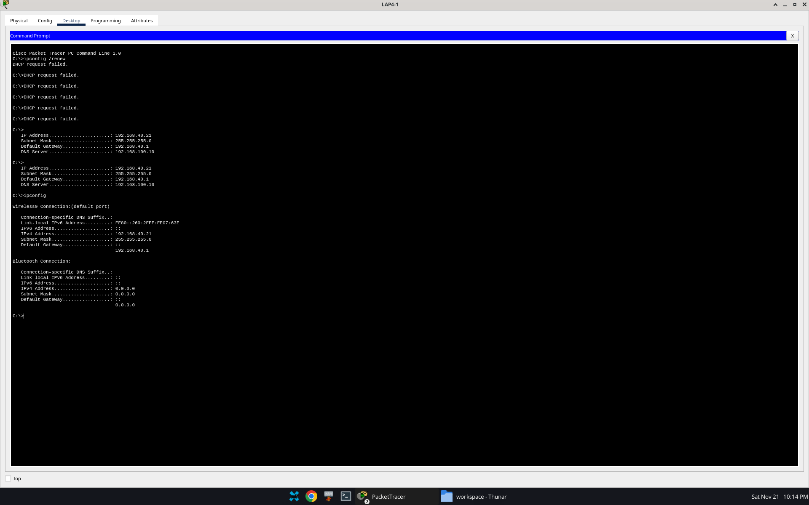

## 10. Páginas web

Las tres páginas abiertas desde el navegador (*Desktop > Web Browser*) de equipos de redes autorizadas, escribiendo el nombre de dominio:

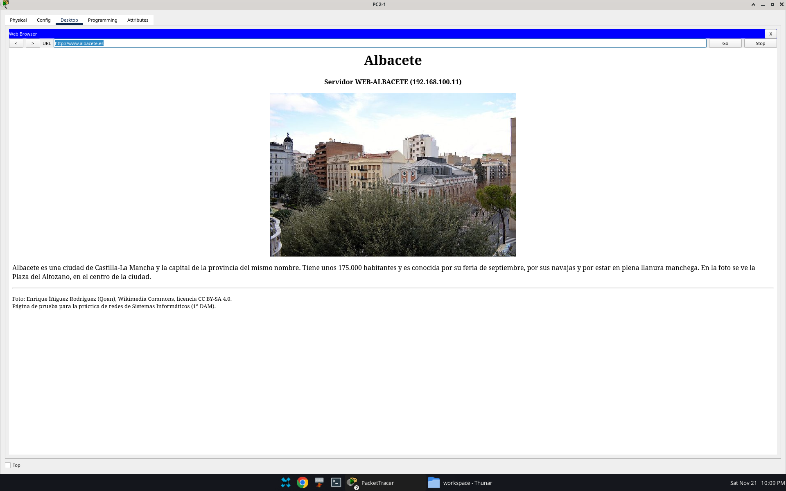


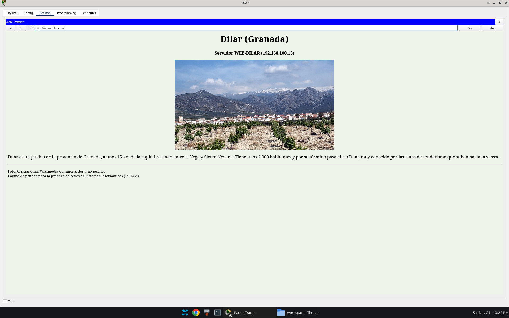

## 11. Pruebas de conectividad y resolución de nombres

<!-- PENDIENTE: rellenar la columna "Resultado" con lo que salga de verdad en Packet Tracer y revisar las capturas -->

Para las pruebas he usado `ping`, `tracert`, `ipconfig /all` y `nslookup` desde *Desktop > Command Prompt*, y el navegador para las webs. Cuando un ping se bloquea por la ACL, lo normal en Packet Tracer es que R1 conteste con `Destination host unreachable`.

| Prueba | Desde | Hacia | Esperado | Resultado |
|---|---|---|---|---|
| Ping en la misma red | PC1-A1 | PC1-A2 (192.168.10.11) | Correcto | **[PENDIENTE]** |
| Ping en la misma red | PC4-1 | LAP4-1 (IP que le dé el DHCP) | Correcto | **[PENDIENTE]** |
| Ping entre redes autorizadas | PC2-1 | PC5-1 (192.168.50.11) | Correcto | **[PENDIENTE]** |
| Ping entre redes autorizadas | PC3-1 | PC4-1 (192.168.40.11) | Correcto | **[PENDIENTE]** |
| Ping entre redes autorizadas | LAP4-1 | WEB-DILAR (192.168.100.13) | Correcto | **[PENDIENTE]** |
| Ping entre subredes de la Red 1 | PC1-A1 | PC1-B1 (192.168.10.130) | Bloqueado | **[PENDIENTE]** |
| Ping desde Red 1 hacia otra red | PC1-C1 | PC5-1 (192.168.50.11) | Bloqueado | **[PENDIENTE]** |
| Ping desde otra red hacia Red 1 | PC5-1 | PC1-A1 (192.168.10.10) | Bloqueado | **[PENDIENTE]** |
| DHCP Red 2 | PC2-1 a PC2-8 | `ipconfig /all` | IP 192.168.20.x, gateway .1, DNS 192.168.100.10 | **[PENDIENTE]** |
| DHCP Red 3 | PC3-1 a PC3-4 | `ipconfig /all` | IP 192.168.30.x, gateway .1, DNS 192.168.100.10 | **[PENDIENTE]** |
| DHCP portátiles | LAP4-1 a LAP4-5 | `ipconfig /all` | IP 192.168.40.21 o superior | **[PENDIENTE]** |
| Conexión al AP | LAP4-1 a LAP4-5 | AP4 | Asociados (se ve la conexión en la topología) | **[PENDIENTE]** |
| Resolución DNS | PC4-1 | `nslookup` de los tres dominios | .11, .12 y .13 | **[PENDIENTE]** |
| HTTP por nombre | PC2-1, PC3-1, LAP4-1 | Las tres webs | Se ven las páginas | **[PENDIENTE]** |
| HTTP desde Red 1 | PC1-A1 | www.albacete.es | No carga (bloqueado) | **[PENDIENTE]** |

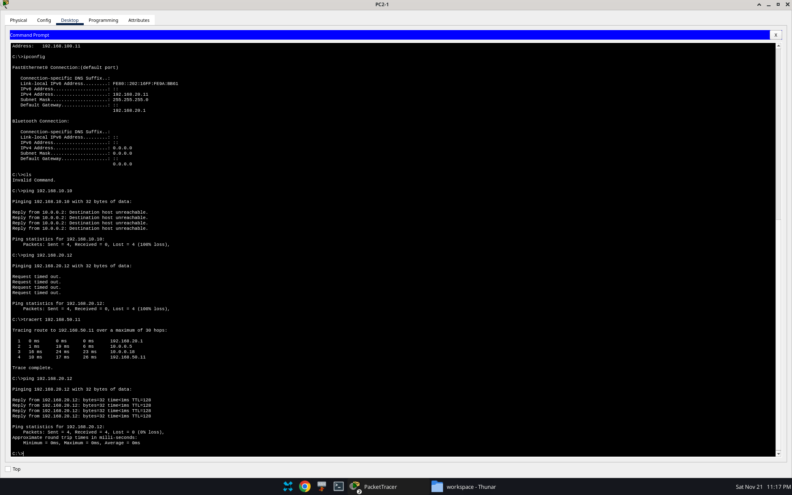

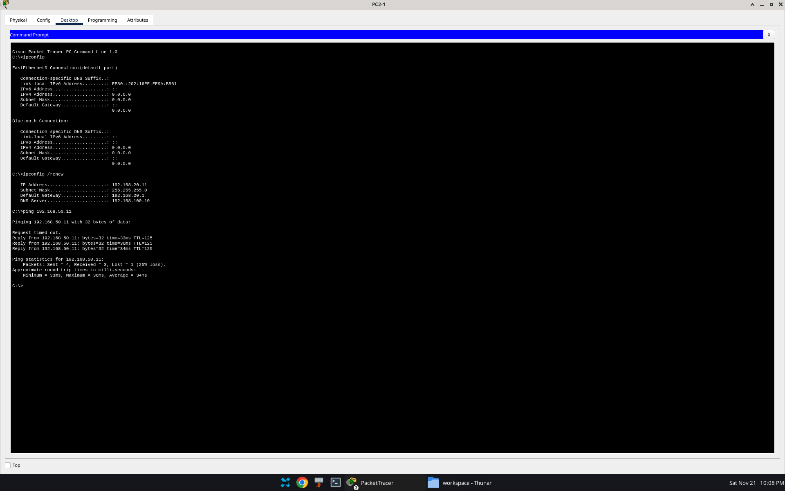

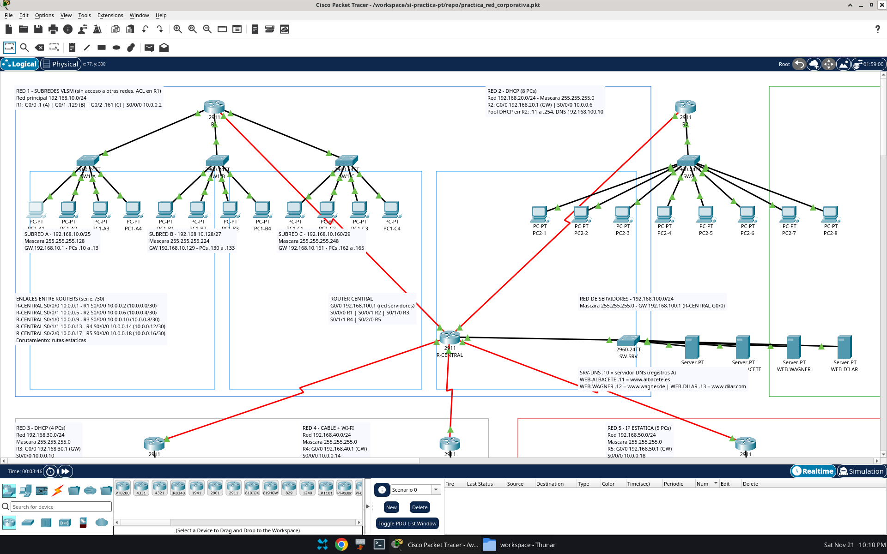

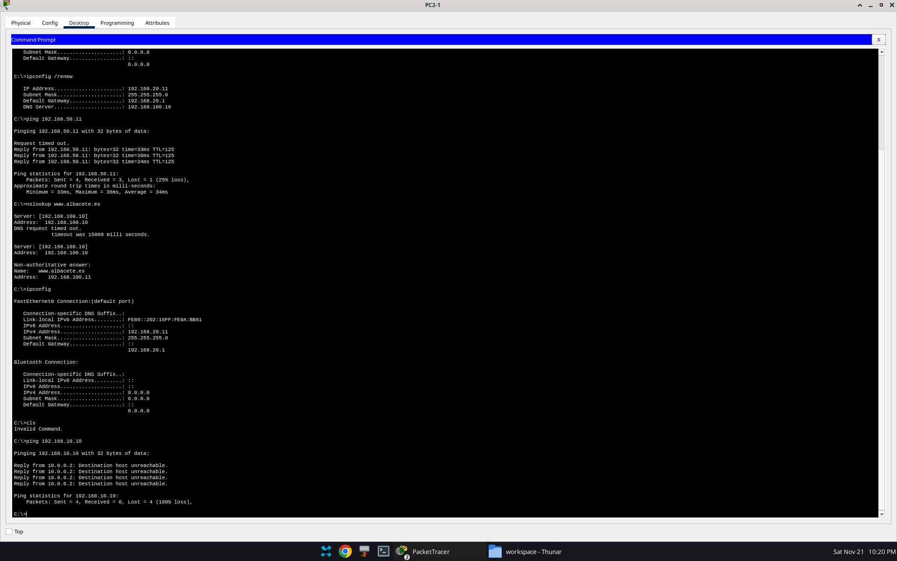

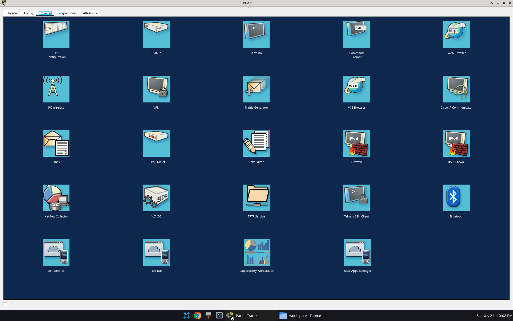

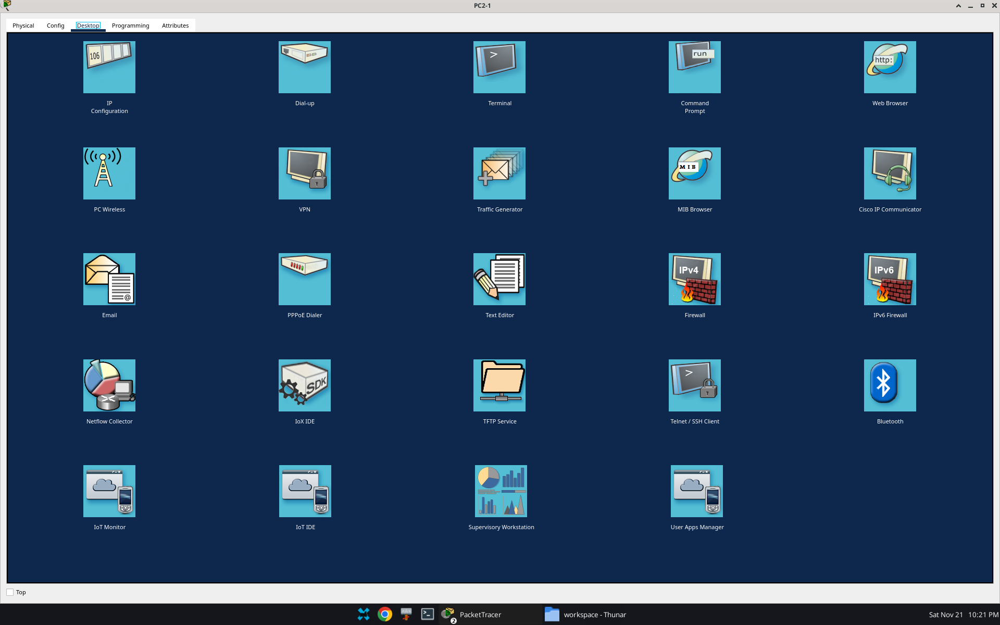

## 12. Problemas encontrados y soluciones

<!-- PENDIENTE: repasar esta lista después de montar la red y añadir lo que pase de verdad -->

**El router 2911 no tiene puertos serie.** Al ir a conectar los routers con cable serie vi que el 2911 solo trae puertos Gigabit. Hay que apagar el router en la pestaña *Physical*, arrastrar una tarjeta HWIC-2T a un hueco libre y volver a encenderlo. En R-CENTRAL hicieron falta tres tarjetas. Si se enciende otra vez sin guardar, la configuración que hubiera se pierde, así que es mejor poner las tarjetas antes de configurar nada.

**Los portátiles no se conectaban al Wi-Fi.** El Laptop-PT viene con una tarjeta de cable. Hay que cambiarla por la WPC300N (con el portátil apagado) y después poner el SSID y la clave en *Config > Wireless0*. Si el SSID o la clave no coinciden exactamente con los del AP el portátil no se asocia.

**Las subredes VLSM necesitan cada una su gateway.** Al principio pensé en poner los 12 PCs de la Red 1 en un mismo switch, pero cada subred necesita su propia puerta de enlace y en un 2911 una interfaz física solo tiene una IP. Lo resolví con un switch por subred y una interfaz de R1 para cada una.

**El enlace serie no se levantaba.** Si no se pone `clock rate` en el extremo DCE la línea se queda caída. Con `show controllers serial` se ve qué extremo es el DCE, y ahí hay que ponerlo.

**Los PCs con DHCP cogían una IP 169.254.x.x.** Pasa si el PC pide la IP antes de que el router tenga el pool configurado. Basta con cambiar a *Static* y volver a *DHCP* en IP Configuration para que la vuelva a pedir.

**Con la ACL el ping hacia la Red 1 llegaba pero no volvía.** Con solo las ACL en las interfaces de las subredes, el paquete de otra red llegaba al PC de la Red 1 y lo que se bloqueaba era la respuesta. Para que el bloqueo sea en los dos sentidos añadí la ACL ENTRADA-RED1 en la interfaz serie de R1.
